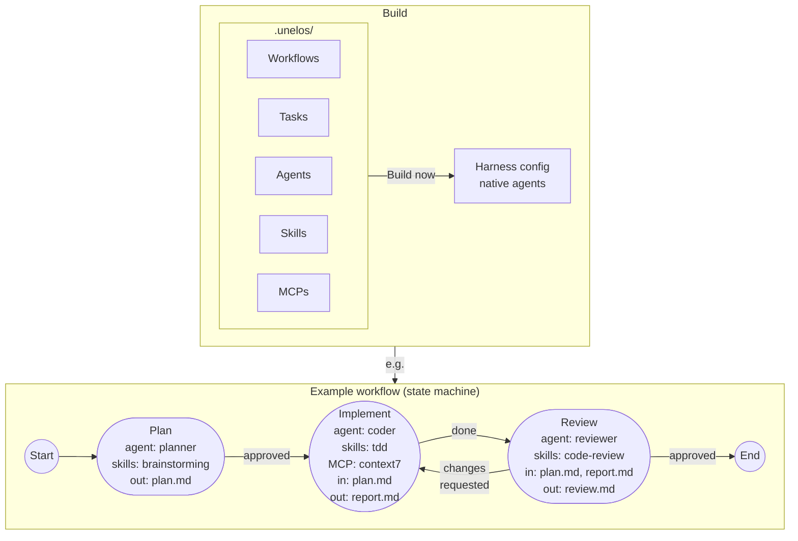
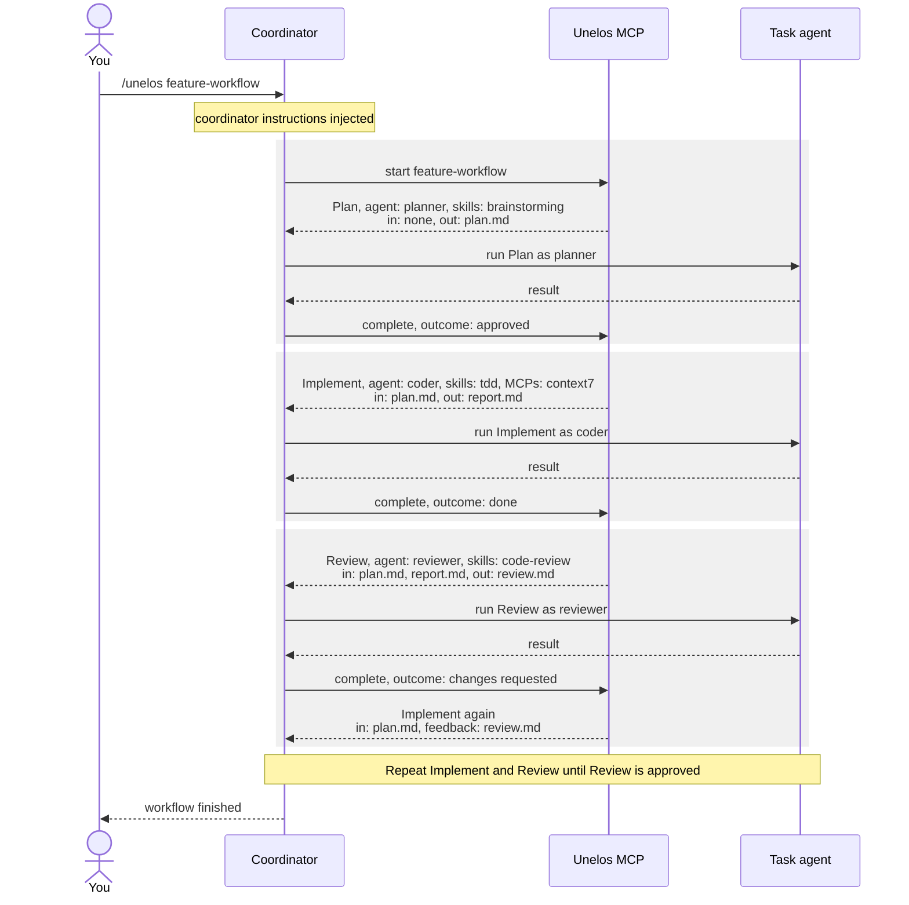

# Unelos

Unelos is a builder and runtime for agentic workflows.
It manages the steps needed to complete mid+ sized tasks, including the agents that perform those tasks, dependencies, required input/outputs, loops, skills and MCPs.
It helps you build Agentic Software Factories and configure your harness.

- [Getting started](#getting-started)
  - [Setting things up](#setting-things-up)
  - [Running a workflow](#running-a-workflow)
  - [Importing workflows](#importing-workflows)
- [Motivation](#motivation)
- [How it works](#how-it-works)
- [Concepts](#concepts)
- [Contributing and running dev locally](#contributing-and-running-dev-locally)

## Getting started

### Setting things up

1. Download the latest build from [Releases](https://github.com/dieguit/unelos-workflows/releases).
   - **macOS:** Pick the `aarch64.dmg` for Apple Silicon or the `x64.dmg` for Intel.
   - **Windows:** Pick the setup `.exe`, or the portable `.zip` if you don't want to install it. For the portable build, extract both `.exe` files together and make sure Microsoft Edge WebView2 Runtime is installed.
   - **Linux:** Pick the `.deb` for Debian or Ubuntu, or the `.AppImage` if you want to run it without installing.

   If your harness runs inside WSL, I suggest running the Linux build inside WSL too, so Unelos can find your harness and its config.

1. Open the GUI and configure your harness(es). Installing Unelos to a harness will:
   1. Add the Unelos plugin and MCP to its global config.
   2. Add the agents used by the built-in workflow-design tool. Model aliases start empty; you map them in the next step.

1. Setup the model aliases: Agents can reference a specific model in a harness, or a model alias. This allows to have multiple harnesses, and use their models when workflows run on each of them. An example for the default model aliases could be fast (codex uses luna, claude code uses haiku), balanced (codex uses terra, claude code uses sonnet), smart (codex uses sol, claude code uses opus).

1. Create some agents, start with generic ones, you can make them more specific when needed.

1. Create your first workflow. Grab a task that you find yourself repeating too much, skills that require steering due to edge cases, etc. Split them in smaller tasks, and think what artifacts need to be validated or iterated.
   
   You can also import some [example workflows](examples/) to get started, they are mostly adaptations of existing stuff (like Superpowers), and adapt them to your needs. (see [Importing workflows](#importing-workflows))
   
   Also, you can use the workflow-design tool (a built-in global workflow) to go through your past sessions, get repeated patterns and suggest workflows. It also has the required skills to create an initial version of the workflow for you.

### Running a workflow

Now that you have some workflows, it's time to run them. Make sure you installed Unelos in your harness, and start
a new session.

If you type just `/unelos` the coordinator will take over and suggest a list of workflows, just follow the instructions.

You can also start with the thing you need to accomplish (like `/unelos I want to...`) and the coordinator will suggest some workflow that matches your intention. For this, it is very important that the name and description in you workflows are good, so coordinator understands what they do.

There's also an "inline workflows" feature, which I found quite useful. If no single workflow covers the whole request, the coordinator can suggest a chain of existing workflows and ask you before starting it.

To pick up a run or turn off Unelos for the session, use `/unelos resume` or `/unelos off` in OpenCode, and `/unelos-resume` or `/unelos-off` in Claude Code. The **Runs** screen shows progress and artifacts; you still answer [gates](#human-gates) in the harness chat.

To try the workflow-design tool, type `/unelos` and pick `global/workflow-design`. It needs Python 3 to look through past sessions.

### Importing workflows

In the Workflows screen you will find a button, you can import from local files (just paste the absolute folder path), and from Github / Gitlab. For the later, make sure you have git installed and have access to the repo.

To try importing from a URL, paste the [Superpowers Dev example URL](https://github.com/dieguit/unelos-workflows/tree/main/examples/superpowers-dev) into the import dialog.

Importing alone doesn't build the harness files. Saving model mappings or workflow changes does if auto-build is on. If you want to run the workflow without changing anything, or if auto-build is off, use **Project settings → Build now**. If your harness doesn't see the new agents, try reopening the session after building.

Always read the skills, MCPs, etc. before importing a workflow from someone else.

## Motivation

As I adopted AI in my day to day work, I tried several tools and popular workflows like Superpowers, OpenSpec, GSD, OMO-Slim, etc. They all work fine, and if you are happy with any of those you should stick to them, but in my case, I found myself trying to improve them to fit my workflows by changing the skills, building plugins, or just constantly steering each session to do what I wanted.

Doing this process for each project became quite time consuming, and as I added more stuff (like MCPs, edge cases, skills), I noticed that context started to get bloated, and results inconsistent.

This project started as a personal tool, a way to manage all that in a simpler way and eventually evolved, by need, to what it is right now.

The main issues this tries to solve are:

- General-purpose workflows (I've used Superpowers and OMO-Slim for a long long time), are okay-ish to customize, but hard to maintain.
- Having a big MCP and Skill pollutes context and agents derail more frequently.
- Building skill-based workflows that dictate behavior, decisions and tasks in one place is very time consuming, and having everything as markdown files makes hard to understand.
- Agents start derailing with skill-based workflows when tasks become longer and more complex.

## How it works

Unelos has two main components: a builder and a runtime.

You will start by building your workflows. There is a built-in tool that suggests workflows from repeated patterns in your sessions, but we will see that later. You can also import workflows, but I suggest you start with something you create by hand and understand.

Workflows in Unelos are basically finite state machines. A task can take inputs and have one or more outcomes. Those outcomes define which step comes next, including whether to go back and try again.

You will define those elements and Unelos will convert them to harness configurations (prompts, agent definitions, etc.).

Second component is the runtime. Once your workflows are in your project and Unelos is set up in your harness, you can run them with `/unelos`.

This will inject the coordinator instructions (similar to `using-superpowers` skill), which will give the coordinator all it needs to run the workflow in the session.

The runtime takes care of navigating the state machine. The coordinator calls the Unelos MCP to start the run, and completing each step returns the next one. The "execution package" contains what the agent needs to work: the task, its instructions and skills, and its inputs and expected outputs. Unelos checks those outputs before moving on.

For me, the main benefit is that the coordinator doesn't have to figure out which step comes next. Unelos follows the routes you defined, while the model still does things like dispatching agents, pulling together their reports and interpreting your answers at gates.

This is not a magic thing that fixes all issues with AI-assisted software development, if you want a workflow that "handles everything", there are good alternatives around. This tool will help you build custom, intentional workflows that fit your reality and project needs.

At runtime, the coordinator starts the workflow and gets the next step each time it completes one:

## Concepts

Here are some concepts that will help you understand how to build good workflows. All the elements described below are simple text files, so you can use the app or any editor to edit them.

### Workflows

A set of steps connected by routes. You can go in order, branch on an outcome, or loop back to an earlier step.

Workflows are composable, so you can call another workflow as part of a bigger workflow. An example of this could be a research workflow that asks questions, dispatches parallel agents to research on something and builds a report, and then another workflow could start with this sub-workflow and start work based on the research outcome.

### Agents

I don't like "personifying" LLMs, but it makes sense to consider agents as the entity that performs an action (or task in our case). They "pack" a set of capabilities, AKA skills, that provide the guidance so LLM behaves as you expect, and MCPs to access external tools. The agent's model and MCPs apply when it runs as a subagent, not when the task runs in your main session.

This allows creating smaller, domain-specific agents, that have deeper context on how to do certain things. You will need to play a bit, depending on your specific use case, with this definitions.
Some agents will be more generic (for example you may have one single "research" agent), or more specific (graphic designer with specific rules, some Figma/Pencil MCP, etc.), or a "developer" agent that has some specific best practices vs a "rust cli dev" vs "frontend react dev", each with specific skills, MCPs and rules that make sense only for them. Play around and see what works best for you.

### Tasks

Tasks are each of the steps on a workflow. As said before, they can expect specific artifacts as inputs, and may produce different outcomes (each with their respective artifacts). Each of those artifacts produced by a task should be considered "proof", and could be code, a PR, a ticket, a report, etc. that next tasks are able to access. The engine will generate the required prompts to ensure (as much as the LLM model allows) that agents produce the expected artifacts.

Tasks also have their own set of skills. Having a distinction between skills for tasks vs skills for agents may be tricky, and you might not need to use both. Personally, it allows me to define simpler agents, so they do not need to have instructions for specific tasks they won't perform very often.

Also, tasks can be defined inline in a workflow (if they are very specific to the workflow), or created as a reusable element that can be referenced by multiple workflows, a good example of reusable tasks could be opening a PR or fetching a ticket from Jira and starting an interview session.

Something to consider, if a task becomes too large or you find out it is doing too many things, you might consider turning it into a small workflow instead.

### Parallel tasks

Unelos can also dispatch tasks in parallel with subagents. The coordinator reads their reports and writes the summary for the next step.

### Human gates

I still think you should try to read the code, at least for non-trivial work. If you think that creates a big bottleneck, at least you can focus in reviewing proof. Try to build tasks and workflows so their outputs are reviewable artifacts.

Workflows can pause at gates so you can review artifacts. The coordinator asks for approval in your harness chat. Reply there to approve or ask for changes.

### Project-scoped vs global

Workflows, tasks, agents, skills and MCPs can be project-scoped or global, so you can build reusable pieces that work across projects.

You might want to start with project-scoped. If a task, skill or MCP turns out to be useful in another project, there is a **Make global** button for that. Project files are stored in `.unelos/` at your project's root, so you can decide whether to gitignore them or share them with your team.
Global definitions live in `~/.config/unelos/`. Only global agents are built into the harness's global agent directory.

## Contributing and running dev locally

See [Contributing](CONTRIBUTING.md)
